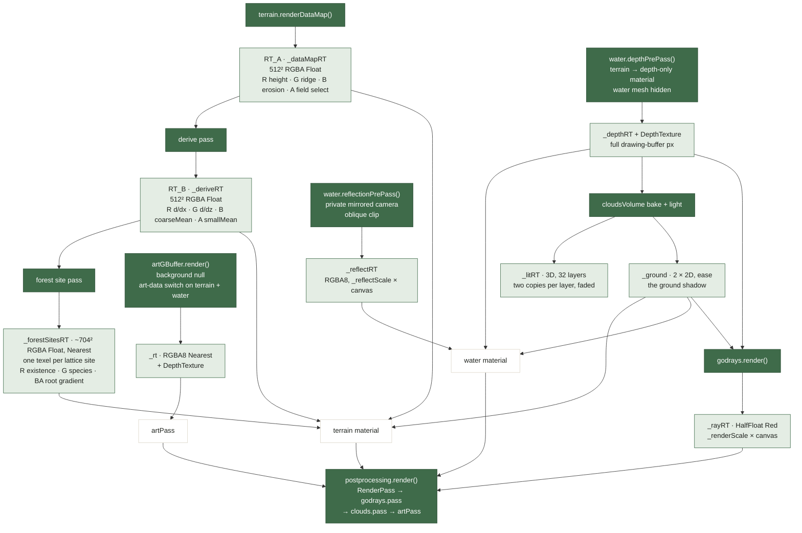

# Architecture Reference

Structural reference: module map, coupling, event payloads, uniform/GLSL
layout. This is a STRUCTURAL doc — algorithms, tuning constants, and the
reasoning behind a module's design live in that module's own header comment
(JSDoc at the top of the `.js`/`.frag`/`.vert` file), not here. This file
should only ever describe SHAPE: what talks to what, and what crosses the
wire between them.

If this file and the code disagree, trust the code and fix this file.


---

## Source layout

| Folder under `src/` | Contents |
|---|---|
| `main.js` | composition root, builds everything and owns the render loop |
| `shared/` | utilities every subsystem may import. `shaderCompose`, `paramAccess`, `uniformValue`, `uniformSerialize`, `paramSchema` (the param row shape), `sceneConfig`, `sceneUniforms` (the scene-wide fog/light/cloud-shadow uniform set), `sceneParams` (that set's rows), `palette` (every authored colour), `simState` (the sim owner), `mathUtils` (clamp), `shaders/noise.glsl` |
| `dynamics/` | `dynamics` (the state machine), `animSpeed`, `dynamicsParams` |
| `drift/` | the unattended drift of the macro look. `formWalker` (the five dials' wander), `terrainForm` (ocean/mountains corner blend), `cloudDialsMath` (scatter/density endpoint maps), `atmosphere` + `atmosphereMath` (overcast/haze walk and the clear/heavy curves), `walk` + `walkMath` (the bounded random walk, with per-channel state in the `Walk` class and the step and draw arithmetic) |
| `terrain/` | `terrain` + driver/math/geometry/uniforms/params, `forestSites`, `treeSpecies`, `shaders/` (+ `includes/`) |
| `water/` | `water` + driver/math/params, `shaders/` |
| `clouds/` | `cloudsVolume` + math/params, `cloudWeatherMap`, `godrays` + params, `shaders/` (+ `includes/`) |
| `artpass/` | `artPass` + prepass/strokes/hold, materials/targets/reveal/params/math, `artPigments`, `artGBuffer`, `shaders/` (+ `includes/`) |
| `audio/` | `audio` + graph/voices/paint/noise/math/params |
| `interaction/` | `interaction` + math/params, `micProbe` + math |
| `scene/` | wiring layer. `weatherDriver`, `sceneSnapshot`, `sceneModules`, `startScene.json`, `frameLogic`, `formDriver` + `formParams`, `horizonColour`, `flyCamera` + params |
| `render/` | `sky` + `skyParams`, `postprocessing`, `pixelRatio`, `display` |
| `panel/` | wiring layer. `debugPanel`, `paramPanel`, `panelLayout`, `panelRows`, `drivenRegistry`, `tooltips`, `perfMath`, `costMeasure`, `fullscreen`, `tabs/` (one file per debug-panel tab) |
| `fonts/`, `style.css` | page assets (`index.html` links the stylesheet) |

Each subsystem folder holds its own shaders. `*Math.js` / `*Logic.js` files are pure (no THREE, DOM or wall-clock) and unit-tested.

---

## Modules

Grouped by what they're responsible for, not alphabetically. `main.js` is the
only module that constructs everything else; everything else either
subscribes to `dynamics`'s events or is handed a value/reference from
`main.js`'s render loop.

| Group | Modules | Role |
|---|---|---|
| Composition root | `main.js` | Builds renderer/scene/camera/every module, owns `THREE.Clock` and the render loop. No uniform names or GL resources of its own. |
| Dynamics core (`dynamics/`) | `dynamics.js` | `Dynamics extends EventTarget` — the sole source of `momentum`/`restlessness`/`noiseTime`/`noiseSpeed`, and the only thing every animated module ultimately subscribes to. |
| | `animSpeed.js` | Water-ripple and cloud-drift pace: target × `dynamics.restlessness`, 0 while a painting holds the scene, eased back up on the art pass's `exitResumeEase`, hurried by the visible overcast. Updated by `main.js` each frame, not tick-subscribed. |
| | `dynamicsParams.js` | Param rows of `dynamics.params` (attention inertia, decay pace, resume threshold) and `animSpeed.params` (target speed, the two weather gains); setters keep their guards as fields. Snapshots keep their flat keys. |
| Terrain (`terrain/`) | `terrain.js` | Plane mesh + `ShaderMaterial` + the heightmap/derive/depth data-map passes. Pure rendering; constructs a private `TerrainDriver`. Public surface: `terrain.params` (get/set/onChange of every terrain value by key) plus the methods that are not one value (`setSegments`, `setFixtureHeightfield`, `setDepthOnly`, the drift and sun readouts, snapshot, lifecycle). |
| | `terrainDriver.js` | The terrain's per-frame animation driver (the two drift headings steered by slow sines, derived `uHeightMax`/`uMantleDC`). Its settings (base speeds, drift switch, freeze) are a plain object that `terrain.params` reaches as fields. Subscribes to `dynamics`'s `tick`. |
| | `terrainMath.js` | Pure tick helpers terrainDriver.js calls — no THREE/DOM/wall-clock, unit-tested. |
| | `terrainGeometry.js`, `terrainUniforms.js`, `treeSpecies.js`, `terrainParams.js` | Geometry factories, the forest uniforms no row seeds, per-species data — each factored out of terrain.js's constructor; the terrain's param rows (every value with a setter, generated per fBM instance and per species). |
| | `forestSites.js` | Pure: the window of forest lattice sites the per-site table must hold. |
| Water (`water/`) | `water.js` | Reflective water plane. Pure rendering; constructs a private `WaterDriver`. Public surface: `water.params` (get/set/onChange of every water value by key: sliders, the sea band as a pair, the driver's bases, the mirror resolution, palette colours, `artData`, `enabled`) plus the methods that are not one value (`withSeaSnap`, the per-frame inputs `setTerrainScale`/`setAnimSpeed`, the outputs `getSeaLevel`/`getRippleTime`/`getDepthTexture`, size, pre-passes, snapshot, lifecycle). |
| | `waterDriver.js` | The water surface's per-frame animation driver (reactive sea level, ripple time, foam/sparkle). Its settings (sea band, foam / sparkle / depth bases) are a plain object that `water.params` reaches as fields. Subscribes to `dynamics`'s `tick`. |
| | `waterMath.js`, `waterParams.js` | Pure reactive maps waterDriver.js calls — unit-tested; the water's param rows. |
| Art pass (`artpass/`) | `artPass.js` | `ArtPass extends Pass` (postprocessing). Orchestrates the paint-lattice reveal/hold/exit animation over a frozen scene: it owns the frame order and the params, and hands the work to three stage classes. Public surface: `artPass.params` (get/set/onChange of every art value by key) plus `enabled`, `playReveal`/`playExit`, the progress and state getters, `setSceneStatic`, size, render, snapshot. |
| | `artPassMath.js`, `artPassParams.js`, `artPigments.js`, `artGBuffer.js` | Pure reveal/exit math, the param rows (the only place an art default lives), the palette's pigment set, the scene-data capture pass artPass reads from. |
| | `artPrepass.js`, `artStrokes.js`, `artHold.js` | The three stages `artPass.js` drives: edge field, ground and growth field; the stroke target with its incremental redraw (lattice tables, dirty mask) and the ground compose; the held picture and the exit dissolve. |
| | `artPassMaterials.js`, `artPassTargets.js`, `artPassReveal.js` | The pass chain's shader materials (each program's uniforms are mounted from what its own GLSL declares, `shaderCompose.mountUniforms`), its render targets, and the reveal/exit state machine (pure: returns `values`, writes nothing). |
| Clouds (`clouds/`) | `cloudsVolume.js` | `VolumeClouds` (main.js's `clouds`) — a rolling 3-D baked density/light volume, raymarched, plus the composite pass. Public surface: `clouds.params` (get/set/onChange of every value by key, the switch included) plus the per-frame inputs (`update(camera, advance, dt)`, which advances the clouds' own clock, `setSceneStatic`, `setDepthTexture`), size, `renderClouds`, `passes`, the readouts (`getShadowFrame`, grid cell/octaves/radius, `getDiagnostics`), snapshot. Terrain, water and godrays read the ground shadow from `uCloudGround`, a 2-D target pair it writes, not from the volume. |
| | `cloudVolumeMath.js`, `cloudWeatherMap.js`, `cloudParams.js` | Pure wind, window-placement and re-anchor math (the region the window must hold, its size from the draw distance); the one-time weather-map bake; the clouds' param rows. |
| | `godrays.js`, `godrayParams.js` | Screen-space light-shaft pass (`godrays.frag` + `godraysComposite.frag`), placed before the clouds in the chain; its param rows. Public surface: `godrays.params` (get/set/onChange of every value by key; march rows mark the march dirty, composite rows do not) plus the per-frame inputs (`setOvercast`, `setSceneStatic`, `setSeaLevel`, `setDepthTexture`), `getWeatherGate`, `markDirty`, size, render, snapshot. |
| Drift (`drift/`) | `formWalker.js`, `formWalkerParams.js`, `terrainForm.js`, `cloudDialsMath.js`, `atmosphere.js`, `atmosphereMath.js`, `atmosphereParams.js`, `walk.js`, `walkMath.js` | The unattended drift of the macro look: the walk of the five dials (ocean, mountains, snowline, cloud scatter, cloud density) and of `overcast` and `haze`, paced by `noiseSpeed` and tick-driven, each walker holding its channels in one `Walk` (`walk.js`); the terrain-form and cloud-dial maps; the weather's clear/heavy blend. Their param rows live in `formWalkerParams.js` and `atmosphereParams.js`; main.js points the walker's `apply` at `form.apply` (scene/), so `drift/` imports only `shared/`. |
| Interaction (`interaction/`) | `interaction.js` | Microphone attention sensor (spectral flux, speaker-leak removal); constant default when the mic is off. |
| | `interactionMath.js`, `micProbe.js`, `micProbeMath.js` | Pure attention-signal math; the mic-level measurement probe and its math. |
| | `interactionParams.js` | Param rows of `interaction.params` (mic tunables; leak delay stored in s, shown in ms via `displayScale`). All `persist: false` (no snapshot). Mic enabling stays an async method. |
| Audio (`audio/`) | `audio.js` | Web Audio facade and orchestrator: wind, trees, surf and birds whose balance follows the scene state (pushed each frame by `main.js`, not tick-subscribed), plus a paint layer for the freeze (its progress is pushed by `main.js` too). It subscribes to no dynamics event. |
| | `audioGraph.js`, `audioVoices.js`, `audioPaint.js`, `audioNoise.js` | Shared node graph, the voice set, the painting-state sound, the noise sources. |
| | `audioParams.js` | The 17 Sound-tab settings as param rows; `audio.params` holds them (mute, solo, voice and reverb side effects are `onChange` hooks in `audio.js`). The snapshot is the flat key map `params.export()`. |
| | `audioMath.js` | Pure forest-cover and mixing math — unit-tested. |
| Scene state (`scene/`) | `sceneSnapshot.js`, `sceneModules.js`, `startScene.json` | Debug-panel export/import: capture and restore every module's tunable state through each module's own `exportState`/`importState` (a shader owner's is by classification, see "Snapshots" below). `startScene.json` is an exported snapshot that `main.js` restores before the render loop starts, so the piece opens on it. |
| | `formDriver.js`, `formParams.js` | The `form` owner: the five dial positions as rows (`form.params`), the one place a position lives; its snapshot entry restores the positions and writes nothing. Each row's setter does that dial's share of the writes (ocean/mountains blend onto terrain and the sea band, snowline written on its own, cloud dials through `cloudDialsMath`); `form.apply(positions, { snapSea })` is the single-blend batch of the walker and `freezeForm`. `formDrivenIds()` is the form driver's claim on the panel. |
| | `weatherDriver.js` | The weather write path (no DOM): `live`, the driven params resolved from `WEATHER_PARAMS` refs to `<owner>.params`, which `atmosphere` captures and writes through, and `applyWeather`. |
| | `frameLogic.js` | Pure per-frame decisions of the render loop: the art pass ↔ dynamics relationship (`isPaintingStill`, `reconcilePaintingHold`, `shouldAdvanceDynamics`, which also skips the attention poll while the reveal plays, `isArtPassAnimating`) and render-target validity (`computeSceneStatic`). |
| | `horizonColour.js` | The horizon colour row whose field fans out to the sky, three's fog, the scene fog colour and the cloud sky copy (main.js's `applyHorizon`). |
| | `flyCamera.js`, `flyCameraParams.js` | The debug free camera (F, WASD, drag); its `enabled` row is `flyCamera.params`. Never touches the landscape; its pose is part of the snapshot. |
| Render (`render/`) | `sky.js`, `postprocessing.js`, `pixelRatio.js` | Sky is a two-colour gradient canvas texture as the scene background (no mesh); postprocessing wires the `EffectComposer` chain (RenderPass → godrays → cloud passes → ArtPass); `pixelRatio.js` is the pure ratio arithmetic of the render-resolution cap. |
| | `skyParams.js`, `display.js` | Rows of `sky.params` (horizon and zenith colours, reach); the `display` owner (the render-resolution cap as one row; it sets the renderer's pixel ratio, and main.js re-sizes the composer and every per-pixel target on its `onChange`). |
| Panel (`panel/`) | `debugPanel.js`, `paramPanel.js`, `panelLayout.js`, `panelRows.js`, `drivenRegistry.js` (which driver currently owns which panel control; the weather master's ids come from the panel rows of the driven params), `tooltips.js`, `perfMath.js`, `costMeasure.js`, `fullscreen.js`, `tabs/*.js` | Debug-overlay wiring; the row-to-control generator and its one binder (`bindParam`); where each row sits; plain-language tooltips; frame-time-breakdown math; the Performance tab's per-part cost measurement; the fullscreen button and its auto-hiding control bar; and one file per tab with readouts or composite controls (clouds, fbm, interaction, overlay, performance, snapshot, sound, species). |
| Shared (`shared/`) | `paramSchema.js`, `paramAccess.js`, `uniformValue.js`, `shaderCompose.js`, `uniformSerialize.js`, `sceneConfig.js`, `palette.js`, `sceneUniforms.js`, `sceneParams.js`, `simState.js`, `mathUtils.js` | The param row shape and its checks; the per-owner key accessor; the one typed writer of a value into a uniform; the GLSL include splice and `mountUniforms`; the snapshot's integrated-uniform capture; shared scene constants; every authored colour (the colour rows' defaults); the scene-wide uniform set (fog, light level, cloud shadow; built once by `main.js` and mounted into terrain, water, godrays, the art pass and the cloud volume) and its rows; the `sim` owner (manual attention, paused); `clamp`/`clamp01`. |

---

## Coupling

- `main.js` constructs every module and is the only place that imports more
  than one of them.
- Beyond that, coupling is not limited to dynamics events: several modules
  own private sub-drivers (`terrain.js`→`TerrainDriver`, `water.js`→`WaterDriver`,
  `artPass.js`'s own internal materials) and `main.js`'s render loop
  explicitly threads values between modules where the ordering matters (e.g.
  `water.getSeaLevel()` → `terrain.params.set('seaLevel')`, `animSpeed.getWaveSpeed()` →
  `water.setAnimSpeed()`, `animSpeed.getCloudSpeed()` → `clouds`'s time accumulator). The rule that
  holds: **subsystems never import each other** (terrain, water, clouds,
  art pass, audio, interaction, drift). A subsystem imports only its own
  helper modules (e.g. `terrain.js`→`terrainDriver.js`, `audio.js`→`audioVoices.js`)
  and `shared/` (`shaderCompose`, `paramAccess`, `uniformValue`, `paramSchema`,
  `uniformSerialize`, `sceneConfig`, `palette`, `mathUtils`, `noise.glsl`); everything else, including
  the one scene-wide uniform set `createSceneUniforms()` builds, is handed in by
  `main.js` at construction. Three layers are wiring and may import pure data
  from subsystems: `main.js`, `scene/` and `panel/` (e.g. `panel` →
  `artpass/artPassParams`, `scene` → `drift/atmosphereMath`).
- `dynamics.js` is the one shared EventTarget (`tick`, `freeze`, `unfreeze`)
  the animated modules subscribe to; `main.js` threads the remaining values.
- `interaction.js`'s `getAttentionLevel()` is read by the debug panel's
  `controls.attention()` in Mic mode (the manual slider otherwise); `main.js`
  passes that value to `dynamics.update()` each frame.
- `terrain.js` (`init`) and `water.js` (per call) receive `THREE.WebGLRenderer`
  for their own data-map / depth / reflection pre-passes; `artGBuffer.js`,
  `cloudsVolume.js` (`renderClouds`), `godrays.js` (`render`) and
  `cloudWeatherMap.js` (`bakeWeatherMap`) do the same. Each saves and restores
  the render target it uses.

---

## Event Payloads

```ts
// dynamics.dispatchEvent every frame it isn't frozen (the freezing frame included),
// and once with dt = 0 from broadcastState()
tick: { dt: number, momentum: number, restlessness: number, noiseTime: number }
// (noiseSpeed is a public property on dynamics, not part of the payload)

// dynamics.dispatchEvent once, on restlessness reaching 0 (hold() freezes without it)
freeze: undefined

// dynamics.dispatchEvent once, on attention dropping below the `unfreezeAttention`
// param, or on wake() while frozen
unfreeze: undefined
```

---

## Uniform Reference

The uniforms are too many to enumerate here — terrain alone carries dozens (fBM/erosion/rock/forest/palette), and the art pass's
paint/reveal/exit shaders carry dozens more. The actual source of truth for
what exists and what drives it:

- **Param rows:** one shape for every param (`shared/paramSchema.js`: id, owner,
  key, kind, uniform, default, range, label, encode, …), declared with the
  owner: `terrain/terrainParams.js`, `water/waterParams.js`,
  `clouds/cloudParams.js`, `clouds/godrayParams.js` (each owner builds its
  accessor from its own rows) and `artpass/artPassParams.js`.
  `panel/panelRows.js` concatenates them with every other owner's rows
  (`shared/sceneParams.js`, `simState.js`, audio, mic, fly camera, sky,
  dynamics, drift, display, form), drops the `hidden` ones and adds the sky swatch.
  A row's `value` is the only default of its uniform: each owner seeds its
  uniform objects from its rows (`uniformsFor`), and
  `tests/unit/paramRows.test.js` proves a freshly built owner holds them.
- **Panel controls are generated from rows.** `index.html` keeps its tabs,
  headings, notes, buttons and readouts, and holds a host `<div
  data-param-group="tab.section">` wherever param controls belong.
  `panel/panelLayout.js` lists the row ids each host receives, in order (the art
  pass's and the species' hosts the panel builds itself);
  `panel/panelRows.js` collects every owner's rows; `panel/paramPanel.js`
  writes each control (`rowHtml`: slider, toggle, colour, radio group) and binds
  it with one function, `bindParam(row, access)`: pull the live value and label
  at bind time, write `access.set` on input, follow `access.onChange` so any
  writer (driver, snapshot import, action) updates the control, re-read `live`
  rows each frame, and drop a write while `drivenRegistry` says a driver owns
  the control. Written by hand: the drift tri-state, the control bar, and the
  composite
  toggles (art-pass on, mic, camera, sound). Adding a param is one row plus its
  id in `panelLayout.js`; the layout test and `tooltips.spec.js` fail if either
  is missing.
- **Forest defaults:** `terrainUniforms.js`, for the forest uniforms no row
  seeds (the per-species arrays, built from `treeSpecies.js`, and two fixed
  constants).
- **Generic accessor pattern:** `paramAccess.js` — one key-based get/set per
  owner over all of its uniform tables (terrain, water, cloud volume, godrays,
  art pass, the scene set; the JS-only owners — dynamics, animSpeed, audio,
  interaction, sky, display, sim, fly camera, form, walkers, horizon — pass no
  tables), instead of hand-rolled pairs. It writes the first table holding the
  uniform, which is correct because inside one owner a uniform name is one shared object
  (`tests/unit/uniformSharing.test.js`). Terrain's is the full form, public as
  `terrain.params`: rows backed by owner fields or by the accessor itself,
  derived uniforms (`uSunAzimuth` from the compass angle), ordered lo/hi
  pairs, a change guard and `onChange` hooks; its header is the pattern the
  other owners follow. Water's is public as `water.params` (its sea band is the
  ordered pair, its driver bases and mirror resolution are fields), godrays' as
  `godrays.params` (rows with `clamp` and `invalidates: 'march'`), the art
  pass's as `artPass.params` (held rows for its JS-only settings, derived
  uniforms for the buffer-scaled sizes (stroke cell, weave scale, normal
  radius, edge fit, growth reach), the relief height, ground blur, edge
  respect and Inspect view, and `invalidates` classes `thaw`, `compose`,
  `lut`, `resize`).

### Snapshots: by classification

A scene snapshot (`sceneSnapshot.js`) is each `SCENE_MODULES` entry's own
`exportState()`. Terrain, water, clouds, godrays and the art pass capture by
**classification**, not by sweeping every uniform. Each uniform of each owner is
exactly one of:

| Class | Meaning | In a snapshot |
|---|---|---|
| row | written by a param row | `params.export()`: the rows by key, minus `persist: false` |
| derived | computed from rows and owner state (a `paramAccess` `derived` entry, or the owner's own step: the terrain range, the cloud grid, godrays' gate) | never captured; the restore recomputes it |
| frame | rewritten every frame or pass (camera, textures, resolution, a pass's per-draw inputs, the art reveal's uniforms) | never captured |
| constant | written once at construction | never captured |
| shared | lives in the scene-wide set | the scene set's own authored values, in terrain's entry (`scene`) |
| integrated | accumulates over time (drift and wind offsets, the cloud window and phases, the clocks) or is the last output of a tick that reads input no snapshot holds (water's foam/sparkle/depth) | captured by name, after the rows |

A state is `{ format: 2, params, integrated?, driver?/enabled?/scene?, … }`. The
classification lives next to each owner: a row's `uniform` field, a
`paramAccess` `derived` entry, or the owner's `UNIFORM_CLASSES` in its
`*Params.js` (`{ uName: 'integrated' | 'derived' | 'frame' | 'constant' |
'row:<key>' }`; `row:<key>` is a uniform written by that row's field, such as
the mantle octaves' two uniforms). `tests/unit/uniformClasses.test.js` builds
every owner and fails on a uniform that is none of these, on a listed name that
matches no uniform, and on a scene-set name that is a copy rather than the set's
object. So a new uniform cannot silently drop out of snapshots: it must be a row
or be classified before the build is green.

Restore runs rows through `params.import` (so derived uniforms, invalidations and
hooks fire as for any write), then writes the integrated uniforms over them, then
the owner's settle step (cloud rebake, terrain range, godrays gate, art-pass
thaw and reveal reset). A snapshot is a still image: the art reveal always lands
fully painted.

**Format guard.** Each shader owner stamps `format: 2` into its state and rejects
any other format (reported as unknown, nothing written). There is no import path
for older shapes.

Two uniforms share the name `uTime` with different sources: terrain's is
`tick.noiseTime` (written by `terrainDriver.js`); water's is the ripple clock
(`waterDriver.js`: dt × wave speed × a momentum pace).

---

## GLSL File Structure

Each subsystem keeps its shaders next to its code; only `noise.glsl` is shared.

- `src/shared/shaders/noise.glsl` — simplex noise, used by terrain, water and clouds
- `src/terrain/shaders/`
  - `terrain.vert` / `terrain.frag` — terrain mesh, displacement + material colour
  - `heightmap.vert` / `heightmap.frag` — data-map pass 1, fBM + erosion → float RT
  - `derive.frag` — data-map pass 2, gradient + ring means → float RT
  - `terrain.frag` with `FOREST_SITE_PASS` — data-map pass 3, per-site tree verdicts → forest site table
  - `includes/` — fbm, erosion, material, dataMapSample, forest (tree-crown shading)
- `src/water/shaders/water.vert` / `water.frag` — water plane with fresnel, glint and foam
- `src/clouds/shaders/`
  - `cloudsVolume.frag`, `cloudVolume{Bake,Light,Weather}.frag` — bake/light/march passes
  - `godrays.frag`, `godraysComposite.frag` — light shafts
  - `includes/` — cloudCommon (clouds + godrays), cloudShade
- `src/artpass/shaders/`
  - `art*.frag` / `artQuad.vert` — the divisionist post-process's pass chain (edge field, ground, growth, lattice table, dirty mask, paint, compose, dissolve, exit count, finish). `artPass.js`'s own header gives the full pass order and why.
  - `includes/` — `art*.glsl`

Includes are imported via Vite's `?raw` and spliced into the owning shader's
source string at compile time (`shaderCompose.js`'s `inject()`), not via any
GLSL-native include mechanism.


---

## Frame order and render targets

### Render-target flow, one frame

Stages run in this order; the loop skips the first three entirely while
`worldHolding` is true. `artGBuffer.render()` runs only while the art pass is
enabled, and not again while the world holds after one valid capture.



The two edges that cross a module boundary are `DEPTH → clouds/godrays` and
`GND → terrain/water/godrays`. Everything else is a module reading its own
output.

### Modules and the artifacts they own

"Artifacts" = the GPU and runtime resources a module allocates and is responsible
for disposing.

| Module | Render targets | Scenes / cameras | Materials | Shaders compiled | Emits / exports |
|---|---|---|---|---|---|
| `terrain.js` | `_dataMapRT`, `_deriveRT`, `_forestSitesRT` | `_heightmapScene`, `_deriveScene`, `_forestSiteScene`, `_heightmapCamera` | terrain, depth-only, heightmap, derive, forest site | terrain.vert/frag, heightmap.vert/frag, derive.frag + 6 includes | `mesh` (added to the scene; drawn depth-only for water's depth pre-pass via `setDepthOnly`), `getSunAzimuth()` (→ clouds), drift readouts (→ panel) |
| `water.js` | `_depthRT` (+DepthTexture), `_reflectRT` | private `_reflectCamera` | water | water.vert/frag + noise | **`getDepthTexture()`** (→ clouds, godrays), `getSeaLevel()`, `getRippleTime()` |
| `cloudsVolume.js` | `_litRT` (3D, 32 layers), `_ground` (two 2-D targets), march RT | — | bake, light, march, composite | cloudVolumeBake/Light/cloudsVolume.frag + 3 includes | **`getShadowFrame()`** (→ the scene-wide uniforms, read by terrain, water, godrays), `uUsableRadius` (its own, in the scene-wide set, read by godrays), composer pass |
| `cloudWeatherMap.js` | weather-coverage RT | — | weather | cloudVolumeWeather.frag | coverage texture (→ cloudsVolume) |
| `artGBuffer.js` | `_rt` + DepthTexture | — | — (flips the `artData` param of terrain and of water) | — | G-buffer + depth (→ artPass) |
| `artPass.js` | via `artPassTargets.js` (+ lattice tables, mask, pick target) | — | 13, via `artPassMaterials.js` | 13 art\*.frag + artQuad.vert + 10 includes | composer pass; `playReveal/playExit`, progress getters |
| `godrays.js` | `_rayRT` | — | march, composite | godrays.frag, godraysComposite.frag | composer pass |
| `postprocessing.js` | composer read/write buffers | — | — | — | owns the fixed pass order |
| `dynamics.js` | — | — | — | — | `tick`, `freeze`, `unfreeze` |

Event fan-out from `dynamics` is runtime (`addEventListener`) and therefore
invisible to an import graph: `tick` → terrainDriver, waterDriver, formWalker,
atmosphere, the panel's fbm/overlay/sound tabs;
`freeze`/`unfreeze` → `main.js` only (which turns them into
`artPass.playReveal()` / `playExit()`).
